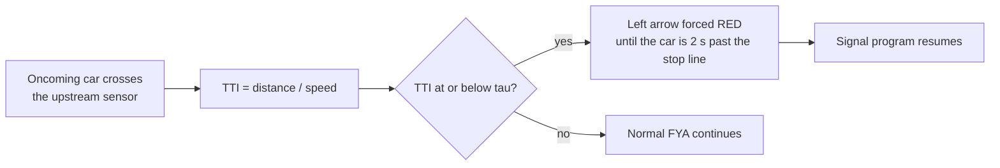
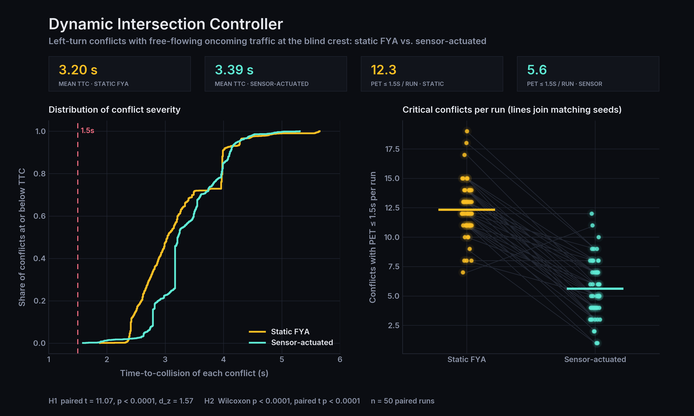
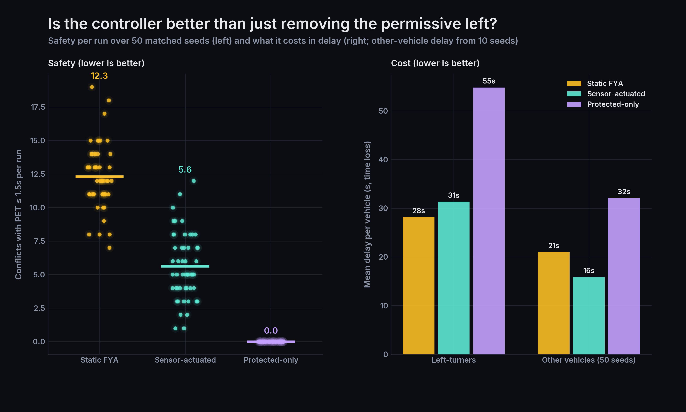

<div align="center">

# Dynamic FYA Crest Controller

**Sensor-actuated phasing for blind-crest intersections.**<br>
See the hidden car. Pull the permissive turn. Before the gap is accepted.

<br>


[Problem](#the-problem) · [Approach](#approach) · [Results](#results) · [Math](#the-math) · [Hypotheses](#hypotheses) · [Case study](#case-study) · [Run it](#run-it) · [Structure](#repository-structure) · [Limits](#limitations) · [Roadmap](#roadmap)

</div>

<br>

## The problem

A Flashing Yellow Arrow (FYA) lets a left-turning driver go when there is a gap in oncoming traffic. That only works if the driver can *see* the oncoming traffic. On a vertical crest curve, the hill hides the oncoming car until it is already close, and a low-eyed sedan driver loses the most view.

A fixed timer cannot react to this. It has no idea whether the car coming over the hill is doing 45 mph or 65.

## Approach

A virtual sensor sits **upstream of the crest** (about 100 m before the stop line), where it can see cars the left-turner cannot yet see. For each car it computes a **time-to-intersection (TTI)**. If the car will arrive too soon for a safe turn, the left arrow is forced red until the car has passed. Otherwise normal FYA continues.



**SUMO has no line of sight**, so a hill in the network does nothing on its own. This project adds one. Each step, every left-turner checks whether any oncoming car is inside its *visible distance*. If none is, it stops checking right of way, like a real driver who has no idea a car is coming. The visible distance comes from the AASHTO crest-curve equation (see below), so a low sedan sees less than a truck.

## Results

Three conditions, **50 matched seeds** (same seed in every condition), counting only *free-flow* conflicts (a left-turner crossing while an oncoming car is moving at 8 m/s or faster; this excludes the low-speed squeeze at the start of each green).

| | Static FYA | **Sensor-actuated** | Protected-only |
|:--|--:|--:|--:|
| Conflicts with PET ≤ 1.5 s, per run | 12.3 | **5.6** | 0.0 |
| Conflicts with TTC ≤ 3 s, per run | 15.6 | **5.8** | 0.0 |
| Mean TTC of conflicts | 3.20 s | **3.39 s** | no conflicts to average |
| Left-turner delay | 28 s | **31 s** | 55 s |
| Other-vehicle delay¹ | 21 s | **16 s** | 32 s |
| Collisions | 0 | 0 | 0 |

¹ From seeds 101–110 (10 runs per condition).

<p align="center">
  
  
</p>

**How to read it.** Against regular FYA, the controller removes about **54%** of the close conflicts for about **3 s** more left-turn delay. Protected-only removes all of them, but left-turners wait about **24 s longer** than with the controller. So of the three conditions tested, the controller gives the best balance of safety and delay. It is *not* safer than protected-only, and the project does not claim it is.

All paired tests: p < 0.0001 (paired t-test for mean TTC, Wilcoxon signed-rank for counts). Full numbers: [`data_outputs/stats_summary.txt`](data_outputs/stats_summary.txt).

## The math

**1. Sight distance over a crest** (AASHTO, when the sight distance $S$ is shorter than the curve $L$)

$$
L = \frac{A\,S^{2}}{100\left(\sqrt{2h_1}+\sqrt{2h_2}\right)^{2}}
$$

For one fixed hill, $A$ and $L$ are constants, so the distance a driver can see scales with $\sqrt{2h_1}+\sqrt{2h_2}$. Anchoring a sedan ($h_1 = 1.08$ m) to the 77 m measured at the real site, with $h_2 = 0.60$ m:

$$
S_i = 77\ \text{m} \times \frac{\sqrt{2h_i}+\sqrt{2(0.60)}}{\sqrt{2(1.08)}+\sqrt{2(0.60)}}
$$

| Driver | Eye height $h_i$ | Visible distance $S_i$ |
|:--|--:|--:|
| Sedan | 1.08 m | 77 m |
| Truck / SUV | 1.80 m | 90 m |
| School bus | 2.40 m | 99 m |

**2. Stopping sight distance.** The intersection is *blind* when $S < \text{SSD}$:

$$
\text{SSD} = 0.278\,v\,t_{pr} + \frac{v^{2}}{254\,(\mu \pm G)}
$$

with $v$ in km/h, $t_{pr}$ the perception-reaction time, $\mu$ the friction coefficient and $G$ the grade as a decimal.

**3. The hidden band.** A left-turner needs $t_{clear}$ seconds to cross. A car that is hidden when the turn starts but arrives before it ends is in the band

$$
w = v\,t_{clear} - S
$$

With $S = 77$ m and $t_{clear} = 4.5$ s: **14 m** at 45 mph, **34 m** at 55 mph, **54 m** at 65 mph. The hazard is mostly a *speeding* hazard.

**4. Controller trigger**

$$
\text{TTI} = \frac{d}{v(t)} \le \tau
$$

where $d$ is the true distance from the sensor to the stop line (about 100 m) and $\tau = 6.0$ s. Rearranged, the controller fires for any car faster than $d/\tau \approx 16.7$ m/s (about 37 mph), which is why it overrides for roughly 90% of oncoming traffic. $\tau$ and $d$ were tuned on seeds 1–3 and tested on fresh seeds 101–150.

**5. Surrogate safety measures** (computed by SUMO's SSM device)

- **TTC**: time until two vehicles would collide if both kept their current speed and path.
- **PET**: time between the first road user leaving the conflict area and the second one arriving.

| Symbol | Meaning | Unit |
|:--|:--|:--|
| $A$ | Algebraic grade difference | % |
| $L$ | Length of the vertical curve | m |
| $S$ | Available sight distance | m |
| $h_1,\ h_2$ | Driver eye height, object height | m |
| $v$ | Vehicle speed | m/s |
| $d$ | Sensor-to-stop-line distance | m |
| $\tau$ | Override threshold | s |

## Hypotheses

**H1 (conflict severity).** The mean time-to-collision under the sensor-actuated controller is higher than under static FYA: $\mu_{SAC} - \mu_{FYA} > 0$. Null: $\mu_{SAC} \le \mu_{FYA}$.
*Result:* 3.20 s → 3.39 s (+0.19 s), paired $t = 11.07$, $p < 0.0001$. A real but small effect.

**H2 (critical near-misses).** The number of critical conflicts per run is lower under the controller than under static FYA. Null: no difference.
*Result:* 12.3 → 5.6 per run, Wilcoxon $p < 0.0001$.

> **Change from the original plan.** H2 was written with TTC ≤ 1.5 s as the "critical" cutoff. In this model that never happened (zero events in every condition), so there was nothing to compare. H2 is therefore reported with **PET ≤ 1.5 s**, and TTC ≤ 3 s is shown alongside it. Mean TTC is also measured only over conflicts that occur, so removing the worst conflicts raises it.

## Case study

The geometry comes from a real blind-crest signalized intersection in Florida, surveyed with Google Earth.

| Distance along the approach | Ground elevation |
|--:|--:|
| 0 m (crest) | 48.66 m |
| 41.8 m (stop line) | 45.74 m |

That is a **7.0% downhill grade** over 41.8 m. At 45 mph on that grade the stopping sight distance is about 125 m, but a sedan driver sees about 77 m, a deficit of roughly 48 m.

## Run it

```bash
git clone https://github.com/GubbGub/dynamic-fya-crest-controller.git
cd dynamic-fya-crest-controller
pip install traci pandas matplotlib scipy
export SUMO_HOME=/path/to/sumo          # SUMO must be installed; no GUI needed

python run_batch.py 3                   # quick test: 3 seeds, all three conditions
python run_batch.py 50 --start 101      # the full experiment (about an hour)
python analyze_data.py                  # tests, figures, stats_summary.txt
```

One run on its own:

```bash
python runner.py --mode baseline  --seed 101    # static FYA
python runner.py --mode dynamic   --seed 101    # sensor-actuated
python runner.py --mode protected --seed 101    # protected-only control
```

SUMO runs **headless** here. The network is built from hand-written XML, so the GUI (and XQuartz on macOS) is not needed. Numbers can shift slightly between SUMO versions.

## Repository structure

```
dynamic-fya-crest-controller/
├── runner.py            one simulation run (baseline, dynamic or protected)
├── run_batch.py         runs many seeds of every condition, then parses
├── parse_ssm.py         turns SUMO's conflict logs into conflicts.csv
├── analyze_data.py      hypothesis tests and figures
├── simulation.sumocfg
├── network/
│   ├── intersection.nod.xml   nodes and elevations
│   ├── intersection.edg.xml   roads
│   ├── intersection.net.xml   built network
│   ├── intersection.rou.xml   traffic demand and speed mix
│   └── sensors.add.xml        upstream induction loops
├── core_logic/          first standalone draft of the trigger math (superseded by runner.py)
└── data_outputs/        figures and stats (raw SUMO XML logs are git-ignored)
```

## Limitations

- **SUMO drivers are too good.** They brake perfectly, which is probably why there were zero collisions. Surrogate measures, not crashes, are the evidence here.
- **Blindness is modeled, not measured.** The 77 m visible distance comes from one real site and is assumed to be measured from the oncoming car's stop line.
- **The controller is blunt.** It overrides for about 90% of oncoming cars, so most of its safety gain comes from rarely allowing a permissive left. What it keeps is much lower delay than a protected phase.
- **The protected control is one design.** It uses an 11 s left arrow and 26 s of through green inside the same 90 s cycle. A different split shifts the delay numbers.
- **Left-turners cross at 5 mph and wait inside the junction** about 14–23 s, which may be longer than real drivers do.
- **Other-vehicle delay** in the table comes from 10 seeds, not 50.

## Roadmap

- [x] SUMO network with the real crest geometry and a 7.0% grade
- [x] Sight-distance blindness layer (class-dependent visible distance)
- [x] Sensor-actuated controller, tuned on separate seeds
- [x] Static FYA baseline and protected-only control, 50 matched seeds each
- [ ] Sensitivity sweep over $\tau$ and sensor distance
- [ ] Mixed left-turning fleet (sedan vs SUV) and varied traffic volume
- [ ] Calibrate the model against real crash and speed data
- [ ] V2X extension: replace the loop with vehicle-reported speed
- [ ] Paper in LaTeX (IEEE T-ITS format)

## References

- Bham, G. H., & Long, S. B. (2014). *Evaluation of the flashing yellow arrow permissive left-turn indication at high-speed intersections.* Missouri DOT.
- Gettman, D., & Head, L. (2003). *Surrogate safety measures from traffic simulation models.* FHWA-RD-03-050.
- Lopez, P. A., et al. (2018). Microscopic traffic simulation using SUMO. *IEEE ITSC*, 2575–2582.
- Florida Department of Transportation (2023). *Florida Greenbook.*

<br>

<div align="center">

Built with SUMO, TraCI and an unreasonable amount of debugging. — Jared Bridgewater

</div>